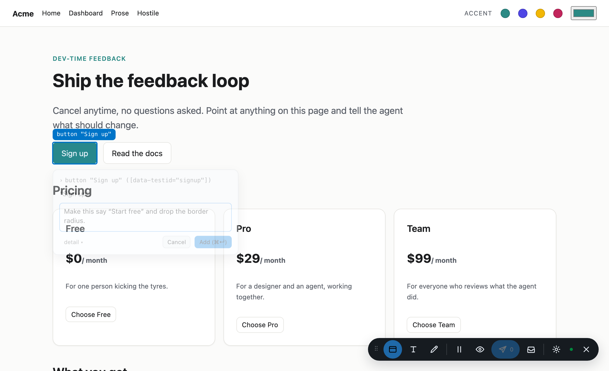
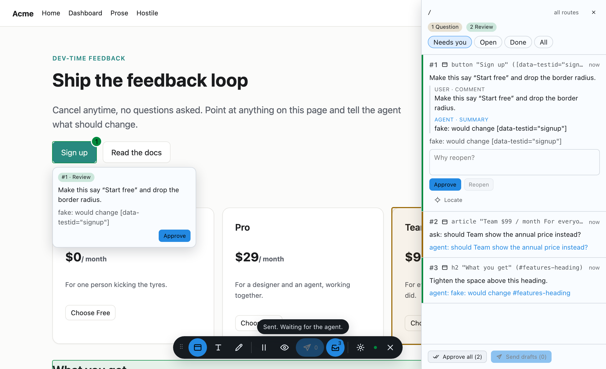

# demo

The Svelte playground every mode is exercised against, and the end-to-end proof that the loop works:
browser → `.annotations/` → `annot` → back to the browser.

```sh
pnpm --filter demo dev            # the playground, overlay auto-injected by the vite plugin
pnpm --filter demo e2e            # every Playwright suite, headless
pnpm --filter demo agent          # the scripted agent, against ANNOT_DIR
```

## Pages

| Path | What it is there for |
|---|---|
| `/` | Marketing page: nav, hero, three pricing cards, feature list, footer. Utility-class soup, so selector generation has to work for it. |
| `/app/` | Dashboard: sidebar, sticky header, repeated table rows, a form, a modal, a card grid, a `<video>`, a CSS animation, and a component in an open shadow root. |
| `/prose/` | Long text with phrases repeated inside one paragraph, for text anchoring. |
| `/hostile/` | `* { all: unset }`, `color-scheme: dark`, a loud `--annot-accent`. The overlay has to stay itself. |

Every page carries an accent picker that writes `--annot-accent` on `:root`. The plugin is configured
without an `accent`, so the overlay follows the host live — that is what suite 6 checks.




Re-shoot both with `node scripts/screenshots.mjs`.

## The scripted agent

`scripts/fake-agent.mjs` loops on `annot watch`, and for each item `ack`s, then answers by comment
prefix: `ask:` asks a question, `decline:` declines, anything else is completed with a summary. It
also completes an item after you answer its question, and does a second pass on a reopen. The e2e
`agent` fixture starts it; run it by hand for a live demo.

## Suites (`e2e/`)

| File | What it proves |
|---|---|
| `element` | Hover chip, popup breadcrumb, draft, send, pin; the stored selector resolves to the same element; drafts delete; a shadow-root element gets a `>>>` selector. |
| `multi-select` | A marquee round the grid selects the three cards; round one card, that card. |
| `text` | The second of two identical phrases is anchored by prefix and suffix, and survives a reload; a two-block selection is one annotation whose `blocks` names both. |
| `loop` | Three annotations through `annot`: review, question, declined; answer in the panel; approve all; reopen. |
| `immediate` | Immediate mode sends on Add, the badge ignores drafts, one batch per annotation. |
| `theming` | The pill, a pin and the `::highlight` rules all re-tint with the host accent; ink on surface clears 4.5:1 for three accents on a dark host. |
| `isolation` | A full session leaves `main` byte-identical; the only thing added to the host is `<style data-annot-highlights>`; the overlay survives `all: unset`. |
| `shortcuts` | The capture layer blocks host clicks, `⌘`-click lets them through; nothing but `⌥A` fires while idle and the host sees `e h i p`; the scoped keys fire in a mode; shortcuts stay out of host inputs; `⌘↵`. |
| `palette` | `⌥A` opens the palette, it filters by comment text and jumps to `#N`, it never offers a loop transition, and the key rebinds and survives a reload. |
| `panel` | A collapsed row sends its draft; three review rows approve together with one undo toast; a mixed selection disables the illegal transitions. |
| `a11y` | axe-core over the overlay with the popup and panel open: no serious or critical violations; every control is named. |

## How the harness works

There is no `webServer`. Each test gets a fixture-owned Vite dev server started in-process against a
fresh temporary `ANNOT_DIR`, so no two tests share storage and every suite starts from nothing. Each
Playwright worker gets its own Vite `cacheDir` (`node_modules/.vite-e2e/<n>`) because concurrent dev
servers sharing one dependency cache serve `504 Outdated Optimize Dep` at each other;
`e2e/global-setup.ts` warms the first cache and copies it to the rest.

While a mode is active the capture layer swallows synthetic clicks by design, so the helpers in
`e2e/overlay.ts` drive real mouse input at coordinates. `document.querySelector('annot-overlay').state`
is the cheapest thing to assert on; `snapshot(page)` serialises it.

## Deviations from spec 08

- Suite 4's "no highlights remain" is asserted as no pins and no outlines: approved items keep no
  visible anchor.
- Spec 09 added `palette` and `panel`; spec 08 lists them.
- Suite 7 diffs `main` and the `data-annot-*` nodes in `<head>`; freeze mode adds a second such node
  (`data-annot-freeze`) while it is on, so the check runs with animations resumed.

## Known gaps

See `docs/known-gaps.md`.
